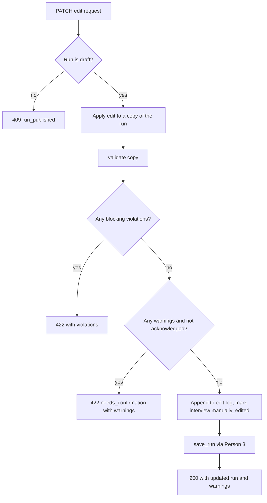
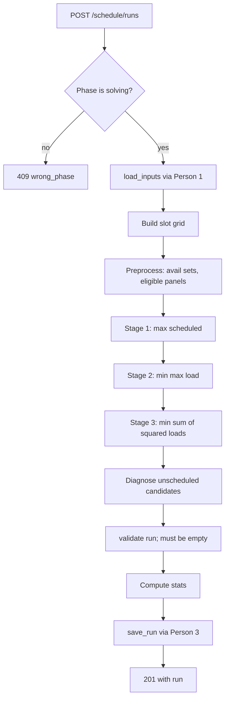

# ADR 0001: Scheduling Solver and Admin Edits

- **Status:** Proposed
- **Date:** 2026-11-14
- **Owner:** Person 2 (see [work-split.md](../work-split.md))
- **Related:** [scheudling-spec.md](../scheudling-spec.md) §6, §8

## 1. Context

Interviewers and candidates each submit availability ranges independently. Interviewers also submit recusals. After the availability phase closes, the system must:

1. Give every candidate an interview time and a panel of *k* interviewers.
2. Schedule as many candidates as possible.
3. Spread interviews evenly across interviewers.
4. Let an admin adjust the draft result by hand before it is published.

Hard rules every schedule must satisfy:

- Every interview sits on the slot grid (fixed length from config).
- The candidate and every panelist are available for the whole slot.
- No panelist is recused from the candidate.
- Each panel has exactly *k* interviewers.
- No interviewer is in two interviews in the same slot.
- Each candidate has at most one interview.
- Optional caps on interviews per interviewer (total and per day) are respected.

Scale: on the order of 200 candidates, 30 interviewers, a few hundred slots.

## 2. Decision

1. **One joint solve.** Times and panels are chosen together in a single model. Picking times first and panels second can produce times that can't be staffed.
2. **OR-Tools CP-SAT** as the solver, behind a pure function `solve(inputs, options) -> ScheduleRun`.
3. **Staged objective.** Each stage locks in the previous stage's result:
   1. Maximize scheduled candidates.
   2. Minimize the maximum interviewer load.
   3. Minimize the sum of squared loads, which evens out the middle.
4. **One rule checker** (`validate`) that both solver output and admin edits must pass. It is the single definition of "valid schedule".
5. **Admin edits apply only to draft runs.** Every edit is re-validated. Violations are either **blocking** (edit rejected) or **warnings** (allowed only when the admin explicitly confirms).
6. **The solver is synchronous.** It runs inside the request with a time limit. A background job is deferred until runtimes require it.

## 3. Features

| # | Feature | Description |
|---|---|---|
| F1 | Slot grid | Build all slots from config: dates, slot length, daily window, timezone. |
| F2 | Preprocessing | Map each person's ranges to the slots they cover; compute eligible interviewers for each candidate and slot. |
| F3 | Rule checker | `validate(run, inputs)` returns every violation, each with a severity. |
| F4 | Solver: coverage | Stage 1: maximize scheduled candidates. |
| F5 | Solver: load balancing | Stages 2–3: minimize max load, then sum of squared loads. |
| F6 | Unscheduled diagnostics | Give each unscheduled candidate a reason. |
| F7 | Run stats | Per-interviewer load, min/max/avg, scheduled and unscheduled counts. |
| F8 | Edit options | For one candidate in a run, list each slot with the interviewers free for it. |
| F9 | Admin edits | Move, set panel, unschedule, place; validated; logged. |
| F10 | Admin edit panel (frontend) | UI for F8 and F9, embedded in Person 3's run-review screen. |

## 4. Logic

### 4.1 Slot grid (F1)

```
for each date in config.interview_dates:
    day_start = date at 00:00 in config.timezone   (or daily_start_time if set)
    day_end   = date at 24:00 in config.timezone   (or daily_end_time if set)
    t = day_start
    while t + slot_length <= day_end:
        emit Slot(start=t → UTC, end=(t + slot_length) → UTC)
        t += slot_length
```

- Build slots in local time, then convert to UTC, so DST transitions are handled correctly.
- Each slot gets an index `s`. All later steps use indexes.

### 4.2 Preprocessing (F2)

1. Use each user's `role` to split availability into interviewers and candidates.
2. Merge overlapping or touching ranges per user.
3. `avail[u]` = the set of slot indexes fully inside one of `u`'s ranges.
4. For each candidate *c* and slot *s* in `avail[c]`:
   - `E[c,s]` = interviewers *i* with *s* in `avail[i]`, minus those recused from *c*.
   - Keep the pair (*c*, *s*) only if `|E[c,s]| ≥ k`.
5. Model variables are created only for the pairs that survive. This keeps the model small.

### 4.3 Solver model (F4, F5)

Variables:

- `x[c,s] ∈ {0,1}`: candidate *c* is interviewed in slot *s*.
- `y[c,s,i] ∈ {0,1}` for *i* in `E[c,s]`: interviewer *i* is on *c*'s panel in slot *s*.
- `load[i] = Σ y[·,·,i]`.

Constraints:

| Rule | Constraint |
|---|---|
| One interview per candidate | `Σ_s x[c,s] ≤ 1` |
| Full panel | `Σ_i y[c,s,i] = k · x[c,s]` |
| No double-booking | `Σ_c y[c,s,i] ≤ 1` for each (*s*, *i*) |
| Total cap (optional) | `load[i] ≤ max_interviews_per_interviewer` |
| Daily cap (optional) | `Σ y[·,s,i]` over slots *s* on day *d* `≤ max_interviews_per_interviewer_per_day` |

Staged solve:

```
stage 1: maximize Σ x                 → N* scheduled
stage 2: add Σ x == N*;  minimize L   where load[i] ≤ L for all i  → L*
stage 3: add L ≤ L*;     minimize Σ load[i]²
```

- Each stage gets a time limit (default 20 s; configurable per run).
- A stage that hits its time limit keeps the best solution found. The run records `solver_status = "feasible"` instead of `"optimal"`.
- Fixed `random_seed`. Tests also use a single worker so results are reproducible.

### 4.4 Unscheduled diagnostics (F6)

Reasons are assigned in order; the first that matches wins:

| Reason | Meaning |
|---|---|
| `no_availability` | The candidate's ranges cover no slot on the grid. |
| `no_full_panel` | Every slot they cover has fewer than *k* available interviewers. |
| `recusals` | A full panel exists only if recused interviewers are counted. |
| `capacity` | Viable slots existed, but other candidates used them (the candidate lost on competition). |

The first three come from preprocessing; `capacity` is anything left.

### 4.5 Rule checker (F3)

`validate(run, inputs) -> list[Violation]`

| Code | Severity | Check |
|---|---|---|
| `off_grid` | block | Interview start and end match a grid slot. |
| `panel_size` | block | Panel has exactly *k* distinct interviewers. |
| `recused` | block | No panelist is recused from the candidate. |
| `double_booked` | block | No interviewer appears in two interviews in the same slot. |
| `duplicate_candidate` | block | Candidate has at most one interview. |
| `candidate_unavailable` | warn | Candidate is available for the slot. |
| `interviewer_unavailable` | warn | Each panelist is available for the slot. |
| `over_total_cap` | warn | Interviewer load ≤ total cap. |
| `over_daily_cap` | warn | Interviewer daily load ≤ daily cap. |

**Invariant (tested):** `validate(solve(inputs), inputs) == []`.

Warnings exist for availability and caps because an admin may have confirmed an exception with the person directly. Breaking any blocking rule produces a schedule that can't actually happen.

### 4.6 Edit options (F8)

`edit_options(run, candidate_id, inputs, include_all=False)`

For each slot (only the candidate's available slots unless `include_all`):

- Free interviewers: available for the slot, not recused, and not booked in another interview in that slot in this run. The candidate's own current interview doesn't count as a booking.
- Each with their current load, so the admin can pick lightly loaded people.
- `candidate_available`: whether the candidate's own availability covers the slot.
- `staffable`: whether at least *k* interviewers are free.

### 4.7 Admin edits (F9)

Edit operations, all scoped to one candidate:

| Op | Body | Effect |
|---|---|---|
| `move` | `start`, `interviewer_ids` *or* `auto_panel: true` | Move the interview to another slot. `auto_panel` picks the *k* least-loaded free interviewers. |
| `set_panel` | `interviewer_ids` | Replace the panel. Covers add, remove and swap. |
| `unschedule` | none | Remove the interview; the candidate moves to unscheduled with reason `manual`. |
| `place` | `start`, `interviewer_ids` *or* `auto_panel: true` | Schedule a currently unscheduled candidate. |

Every request also carries `acknowledge_warnings: bool`.

Edit workflow:



### 4.8 Solve workflow



## 5. APIs

All endpoints are admin-only. The caller is identified by the `X-User-Id` stub for now.

| Method | Endpoint | Description | Errors |
|---|---|---|---|
| `POST` | `/schedule/runs` | Run the solver and save a draft run. Optional body: `{ "time_limit_s": 20, "seed": 0 }`. Returns `201` with the run. | `403`, `409 wrong_phase` |
| `GET` | `/schedule/runs/{id}/validation` | Current violations for a run. Used by the review screen after edits. | `403`, `404` |
| `GET` | `/schedule/runs/{id}/options/{candidate_id}` | Edit options (§4.6). Query: `include_all=true` to include slots outside the candidate's availability. | `403`, `404` |
| `PATCH` | `/schedule/runs/{id}/interviews/{candidate_id}` | Apply one edit (§4.7). | `403`, `404`, `409 run_published`, `422` |

Listing, reading and publishing runs are Person 3's endpoints.

Example edit request and blocked response:

```json
PATCH /schedule/runs/r1/interviews/c3
{ "op": "set_panel", "interviewer_ids": ["i1", "i2"], "acknowledge_warnings": false }

422
{ "error": "blocked",
  "violations": [
    { "code": "recused", "severity": "block", "candidate_id": "c3",
      "interviewer_id": "i2", "message": "Ben is recused from Casey." } ] }
```

## 6. Python interfaces

```python
# app/scheduling/slots.py
def build_slots(config: Config) -> list[Slot]: ...

# app/scheduling/preprocess.py
def preprocess(config, users, availability, recusals) -> SolverInputs: ...

# app/scheduling/solver.py   (pure: no file or network I/O)
def solve(inputs: SolverInputs, options: SolveOptions) -> ScheduleRun: ...

# app/scheduling/rules.py
def validate(run: ScheduleRun, inputs: SolverInputs) -> list[Violation]: ...

# app/scheduling/stats.py
def run_stats(run: ScheduleRun, inputs: SolverInputs) -> RunStats: ...

# app/scheduling/edits.py
def edit_options(run, candidate_id, inputs, include_all=False) -> list[SlotOption]: ...
def apply_edit(run, edit: Edit, inputs, acknowledge_warnings: bool) -> EditResult: ...

# app/routers/schedule.py   (thin: phase/role checks, I/O, HTTP mapping)
```

`SolverInputs`, `SolveOptions`, `SlotOption`, `EditResult` and `RunStats` are internal to Person 2 and live in Person 2's modules.

## 7. Shared model changes

These go in `app/scheduling/models.py` and need a PR reviewed by all three people:

```python
class Severity(str, Enum): BLOCK = "block"; WARN = "warn"

@dataclass
class Violation:
    code: str
    severity: Severity
    message: str
    candidate_id: str | None = None
    interviewer_id: str | None = None

class EditOp(str, Enum): MOVE = "move"; SET_PANEL = "set_panel"; UNSCHEDULE = "unschedule"; PLACE = "place"

@dataclass
class Edit:
    op: EditOp
    candidate_id: str
    start: datetime | None = None
    interviewer_ids: list[str] | None = None
    auto_panel: bool = False

@dataclass
class EditLogEntry:
    edit: Edit
    by_user_id: str
    at: datetime
    acknowledged_warnings: list[Violation]

# additions to existing classes
Interview.manually_edited: bool = False
ScheduleRun.solver_status: str = "optimal"            # "optimal" | "feasible" | "infeasible"
ScheduleRun.unscheduled_reasons: dict[str, str]        # candidate_id -> reason (§4.4)
ScheduleRun.edit_log: list[EditLogEntry]
```

## 8. Testing

- **Unit tests per module:**
  - slot grid: daily window, DST week, a slot length that doesn't divide the window
  - preprocessing: merged ranges, recusal pruning
  - each rule in `validate`
  - each edit op
- **Invariant:** every solver output passes `validate` with no violations, on every fixture.
- **Optimality cross-check:** on tiny instances (≤ 4 candidates, ≤ 4 slots), brute-force enumeration must match the solver's scheduled count and max load.
- **Fixtures** (`data/solver/`):
  - `basic.json`: the shared `testinterviewdata.json`.
  - `scarce_slot.json`: many candidates competing for one staffable slot.
  - `heavy_recusals.json`: recusals block most panels.
  - `unschedulable.json`: one candidate for each diagnostic reason.
  - `caps.json`: caps that bind.
  - `large_random.json`: about 200 candidates and 30 interviewers, checked against a runtime budget.

## 9. Milestones

| # | Deliverable | Unblocks |
|---|---|---|
| M1 | Slot grid and preprocessing, with tests | Everything below |
| M2 | Rule checker | Solver invariant; edits |
| M3 | Solver stage 1 | First end-to-end run |
| M4 | Load-balancing stages | Final solver output |
| M5 | Diagnostics and stats | Person 3's review screen |
| M6 | `POST /schedule/runs` | Integration with Persons 1 and 3 |
| M7 | Edit options, `apply_edit`, PATCH and validation endpoints | Admin edits |
| M8 | Admin edit panel (frontend) | Feature complete |

## 10. Alternatives considered

| Option | Why not |
|---|---|
| Greedy (place candidates one by one) | Fast and simple, but order-dependent. It can leave schedulable candidates out and balances load poorly. |
| Time first, then panels | The time choice can't see panel conflicts, so it can pick times that can't be staffed. |
| Max-flow / bipartite matching | Can't express panels of size *k* combined with per-pair recusals and a joint choice of time. |
| MILP via PuLP + CBC | Would work, but CP-SAT is faster on this kind of 0/1 problem, ships as one wheel, and handles the squared-load objective. |
| Weighted single objective | Weights trade coverage against balance unpredictably. Staging guarantees coverage is never sacrificed. |

## 11. Consequences

- New dependency: `ortools` (`uv add ortools`).
- Solver results are optimal (or best-found within the time limit) and reproducible with a fixed seed.
- The solver can't explain itself directly, so the diagnostics (§4.4) and stats carry that load for admins.
- One rule checker means solver bugs and bad edits are caught the same way.
- Synchronous solving blocks the request for up to about a minute. That's acceptable for a single admin; move it to a background job if runtimes grow.

## 12. Open questions

- **How load balancing is measured:** absolute (everyone near the same count), or in proportion to how much availability each interviewer gave?
- **Buffers:** should one interviewer get a break between back-to-back interviews?
- **Day spread:** should the solver prefer fewer interview days per interviewer?
- **Panel composition:** any future rules, such as at least one experienced interviewer per panel?
- **Re-solve with locks:** later, re-run the solver keeping manually edited interviews fixed. The model supports this by fixing `x` and `y` for locked interviews.
