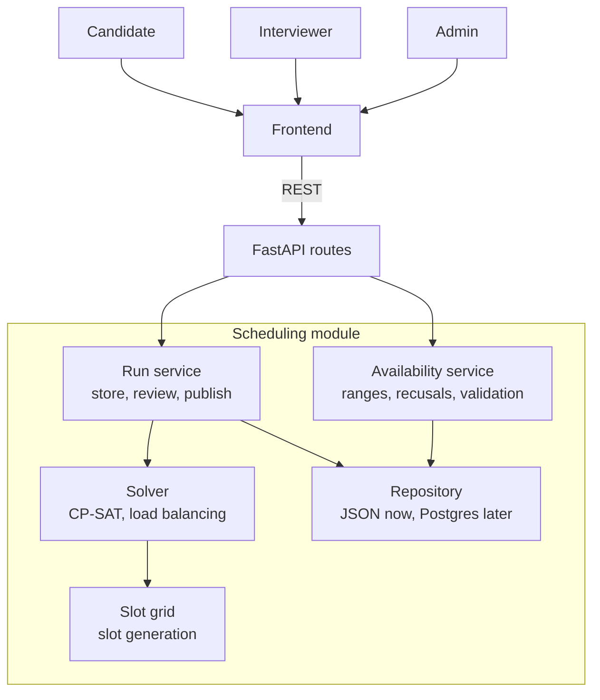

# Interview Scheduling Spec

## 1. Overview

The scheduling module lets **interviewers** and **candidates** each submit the time ranges they are available, lets interviewers declare **recusals** (conflicts of interest) with specific candidates, and then runs a **solver** that assigns every candidate an interview time and a panel of interviewers.

Candidates do not pick a time. They submit availability; the solver picks the time after the submission window closes.

The solver's goals, in priority order:

1. Schedule as many candidates as possible.
2. Spread interviews evenly across interviewers (load balancing).

## 2. Scope

### In scope (current build)

- Admin-defined scheduling config (interview length, dates, panel size, limits).
- Interviewer availability and recusals.
- Candidate availability, collected and validated the same way as interviewer availability.
- A solver that assigns candidate times and interviewer panels with load balancing.
- Admin review and publish of solver results.
- Each user can view their published interviews.

### Deferred

- **Persistence:** the current build reads and writes JSON dummy data (`backend/data/`). Postgres/Supabase comes later behind the same repository interface (see §9).
- **Auth:** Supabase sign-in and JWT verification come later. Until then the caller is identified by a stub `X-User-Id` header and roles are looked up from the dummy data.
- **Rescheduling and post-publish changes** (candidate drops out, interviewer cancels).
- **Google Calendar invites.**

## 3. Roles

| Role | Can do |
|---|---|
| Admin | Edit config, advance phases, run the solver, publish results. |
| Interviewer | Submit availability and recusals; view own published interviews. |
| Candidate | Submit availability; view own published interview. |

## 4. Phases

The scheduling cycle moves through fixed phases. Only an admin advances the phase, and each endpoint checks the current phase before accepting a write.

| Phase | Writes allowed |
|---|---|
| `setup` | Admin edits config. |
| `availability` | Interviewers and candidates submit availability; interviewers submit recusals. |
| `solving` | Admin runs the solver (any number of times), edits drafts, and reviews runs. All availability is frozen. |
| `published` | One run is published; users can see their interviews. |

Interviewers and candidates submit at the same time and never see each other's availability.

## 5. Config

Set by an admin during `setup`.

| Field | Meaning |
|---|---|
| `slot_length_min` | Length of every interview, in minutes. |
| `interview_dates` | Dates on which interviews may happen. |
| `timezone` | IANA timezone used to interpret dates and display times (e.g. `America/Chicago`). Times are stored in UTC. |
| `daily_start_time` / `daily_end_time` | Optional window (e.g. `09:00`–`18:00`, in `timezone`) that all availability must fall inside. |
| `interviewers_per_interview` | Panel size *k* for every interview. |
| `min_candidate_minutes` | Minimum total availability a candidate must submit. |
| `min_interviewer_minutes` | Minimum total availability an interviewer must submit (0 = none). |
| `max_interviews_per_interviewer` | Optional hard cap on total interviews per interviewer. |
| `max_interviews_per_interviewer_per_day` | Optional hard cap per interviewer per day. |
| `phase` | Current phase (§4). |

## 6. Slot Grid

All interviews start on a fixed grid so that interviews never partially overlap.

- On each interview date (in `timezone`), slots start at midnight and every `slot_length_min` minutes after.
- A person is **available for a slot** if the slot lies entirely within one of their availability ranges.
- Availability ranges do not need to align to the grid; only the slots fully inside a range count.
- Overlapping or touching ranges from the same person are merged on write.

## 7. Availability Validation

Interviewers and candidates use the same collection and validation logic. Neither side sees the other's availability, and validation reads only the config and the submitter's own ranges.

A submission is accepted only if:

1. Every range has `end > start`.
2. Every range falls on an `interview_dates` date and, if set, inside the daily window.
3. Total submitted time (after merging overlaps) is at least `min_candidate_minutes` or `min_interviewer_minutes`, depending on role.

Otherwise it is rejected with a `422` saying which rule failed.

**Trade-off:** a candidate may submit only times when no full panel of interviewers is free. This is detected at solve time: the solver lists them as unscheduled, and the admin places them by hand or asks for more availability. The daily window and minimum-minutes rules keep this rare.

## 8. Solver

### Inputs

Config, all availability, all recusals, and the list of candidates and interviewers.

### Model

Let *S* be the set of grid slots. For each candidate *c*, slot *s*, and interviewer *i*:

- `x[c,s]` = 1 if candidate *c* is interviewed in slot *s*. Allowed only if *c* is available for *s*.
- `y[c,s,i]` = 1 if interviewer *i* is on *c*'s panel in slot *s*. Allowed only if *i* is available for *s* and has no recusal with *c*.

Constraints:

1. Each candidate is interviewed at most once: `Σ_s x[c,s] ≤ 1`.
2. Every interview has a full panel: `Σ_i y[c,s,i] = k · x[c,s]`.
3. An interviewer is in at most one interview per slot: `Σ_c y[c,s,i] ≤ 1`.
4. Optional caps: total and per-day interview counts per interviewer stay within the config limits.

### Objective

Solved in two stages so that load balancing never costs a scheduled candidate:

1. Maximize the number of scheduled candidates, `Σ x`.
2. With that number fixed, minimize the maximum interviewer load, then minimize the total deviation from the average load.

The intended implementation is OR-Tools CP-SAT, with a fixed random seed so runs are reproducible. The solver sits behind a single function (`solve(inputs) -> ScheduleRun`) so it can be replaced.

### Output

A `ScheduleRun` containing:

- The proposed interviews (candidate, slot, interviewer panel).
- Candidates who could not be scheduled.
- Per-interviewer load, for admin review.

Runs are stored, not applied. An admin compares runs and publishes one.

## 9. Core Entities

| Entity | Fields | Notes |
|---|---|---|
| `User` | `id`, `name`, `email`, `role` | `role` is `admin`, `interviewer`, or `candidate`. |
| `Config` | see §5 | One per cycle. |
| `Availability` | `user_id`, `start`, `end` | Used by both interviewers and candidates. |
| `Recusal` | `interviewer_id`, `candidate_id`, `reason` | Unique per pair. |
| `ScheduleRun` | `id`, `created_at`, `status`, `interviews`, `unscheduled_candidate_ids` | `status` is `draft` or `published`. At most one published run. |
| `Interview` | `candidate_id`, `start`, `end`, `interviewer_ids` | Belongs to a run. |

Data access goes through a repository layer (`load_*` / `save_*` functions). The current implementation reads and writes JSON files; a Postgres implementation can replace it later without changing services or routes.

## 10. APIs

The caller's identity and role come from the `X-User-Id` stub header (later: the JWT). Every write also checks the current phase.

| Method | Endpoint | Role | Description |
|---|---|---|---|
| `GET` | `/config` | any | Read config and current phase. |
| `PUT` | `/config` | admin | Update config (`setup` only). |
| `POST` | `/config/phase` | admin | Advance to the next phase. |
| `GET` | `/availability/me` | interviewer, candidate | Read own availability ranges. |
| `PUT` | `/availability/me` | interviewer, candidate | Replace own availability ranges, validated per §7. |
| `GET` | `/recusals/me` | interviewer | Read own recusals. |
| `PUT` | `/recusals/me` | interviewer | Replace own recusals. |
| `POST` | `/schedule/runs` | admin | Run the solver; returns a draft run (`solving` only). |
| `GET` | `/schedule/runs` | admin | List runs with summary stats. |
| `GET` | `/schedule/runs/{id}` | admin | Run details: interviews, unscheduled candidates, loads. |
| `POST` | `/schedule/runs/{id}/publish` | admin | Publish a run and move to `published`; returns notification results. |
| `GET` | `/interviews/me` | interviewer, candidate | Own interviews from the published run, formatted in the configured timezone. |

Errors: `403` for wrong role, `409` for a write in the wrong phase, `422` for invalid ranges or a submission below the role's minimum minutes.

### Run review and publish response shapes

`GET /schedule/runs` returns one summary per run:

```json
{
  "id": "run-id",
  "status": "draft",
  "phase": "solving",
  "timezone": "America/Chicago",
  "created_at": "2026-12-01T00:00:00Z",
  "scheduled_count": 3,
  "unscheduled_count": 1,
  "max_interviewer_load": 3
}
```

`GET /schedule/runs/{id}` returns the interviews, named unscheduled candidates,
per-interviewer loads, the current phase, and the configured timezone. Interview
times remain UTC in this admin response; clients format them using `timezone`.

`POST /schedule/runs/{id}/publish` returns:

```json
{
  "run": { "...": "run detail response" },
  "emails_sent": 0,
  "emails_written": 3,
  "emails_skipped": 0,
  "email_failures": []
}
```

Publishing is allowed only during `solving`. It is the source of truth: the run
and config phase are persisted as published before notifications are attempted.
Notification failures are reported in `email_failures` and do not undo
publication. A second published run is rejected with `409`.

`GET /interviews/me` returns a list of display records:

```json
{
  "status": "scheduled",
  "candidate_id": "c1",
  "candidate_name": "Alex",
  "start": "2026-12-01T09:00:00-06:00",
  "end": "2026-12-01T09:30:00-06:00",
  "timezone": "America/Chicago",
  "panel": [{ "id": "i1", "name": "Ana" }],
  "message": null
}
```

Candidates receive only their own interview and panel names (never panel email
addresses). Interviewers receive only interviews on their panels. Before a run
is published the endpoint returns `[]`; a published but unscheduled candidate
receives a `not_scheduled` record with a message.

### Notification environment and safe testing

The backend reads these server-only variables:

| Variable | Purpose |
|---|---|
| `EMAIL_DRY_RUN` | Defaults to dry run when unset or invalid. Only the explicit value `false` enables Gmail sending. |
| `GOOGLE_CLIENT_ID` | Google OAuth client ID. |
| `GOOGLE_CLIENT_SECRET` | Google OAuth client secret. |
| `GOOGLE_REFRESH_TOKEN` | Refresh token for the Gmail account. |
| `GOOGLE_GMAIL_SCOPE` | Gmail scope; use `https://www.googleapis.com/auth/gmail.send`. |

`GOOGLE_FORM_ID` is retained for the existing Google integration but is not
needed for schedule notification delivery. In dry-run mode, one readable
`.eml` file per recipient is written under `backend/data/outbox/`; that
directory is ignored by Git. Unscheduled candidates receive no email.

To test safely, leave `EMAIL_DRY_RUN` unset (or set it to `true`), publish a
sample or test run, inspect the generated `.eml` files and the publish response,
and verify that no Gmail API call occurs. Only after this check should a test
account set `EMAIL_DRY_RUN=false` with the Gmail OAuth variables configured.

## 11. Architecture

The scheduling module is part of the FastAPI monolith.



## 12. Open Questions

- Should candidates be able to rank or weight their availability (preferred vs. possible)?
- Is a buffer between consecutive interviews for the same interviewer needed?
- Should the solver also prefer fewer interview days per interviewer?
- How should unscheduled candidates be handled: manual admin assignment, or a second availability round?
