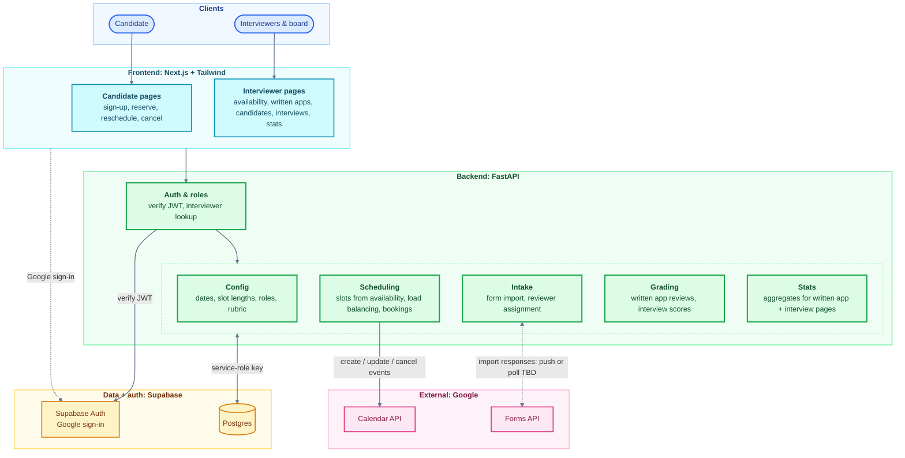

## Project Architecture Diagram:

### Other rules

- The frontend uses Supabase **only for sign-in**. Every data R/W is through FastAPI. FastAPI enforces candidate vs. interviewer access.
- Candidates can only reach Scheduling.
- The Supabase service-role key lives only in the backend.
- Calendar invites are sent **only** by the backend , whenever a booking is created, changed or cancelled.
